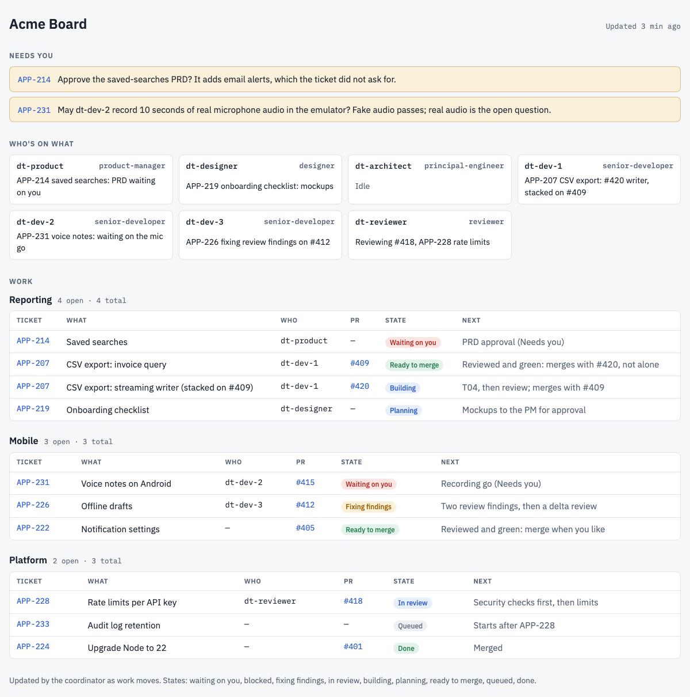

# dev-team

A [Claude Code](https://code.claude.com) plugin that runs feature work the way a small software team does. Six roles take a request from requirements to reviewed code and write everything down in your repo as they go. You sign off where it matters and nowhere else.

**Docs: [j-t-mcc.github.io/dev-team](https://j-t-mcc.github.io/dev-team/)**

## Install

```
/plugin marketplace add J-T-McC/dev-team
/plugin install dev-team@dev-team
```

Run both inside your project and pick **Install for you, in this repo only (local scope)**. User scope would load the plugin into every session in every project. Then ask Claude to `set up dev-team in this project` ([Get started](https://j-t-mcc.github.io/dev-team/getting-started/)).

You need macOS or Linux (WSL on Windows) and git. Orca, the Owner board, check-ins and the audit also need Python 3.9+, and Orca and the board need the GitHub CLI (`gh`).

## How it works

A request moves from the product manager to the designer (UI work only), the principal engineer, a senior developer and the reviewer, routed by an orchestrator. Each hands off through a document in your repo, so nothing lives only in a chat. Small work takes a shorter path, and bugs go straight to a developer ([Pipeline](https://j-t-mcc.github.io/dev-team/pipeline/)).

You decide how much you're asked, from every step to only what's irreversible, risky or costly, and whether the team starts new work on its own ([Autonomy](https://j-t-mcc.github.io/dev-team/autonomy/)).

## Two ways to run it

By default every role runs in your own Claude Code conversation, one at a time, and an agent starts only when it pays for itself. On the [Orca runtime](https://j-t-mcc.github.io/dev-team/orca/), every role is its own session and several developers build at once; your session coordinates. That costs more, since every task starts a fresh session. Either way, each session loads your project's own setup, so trim what the roles don't use ([What your project costs](https://j-t-mcc.github.io/dev-team/costs/)).


## Extras

Off until you set them up.

- [Orca runtime](https://j-t-mcc.github.io/dev-team/orca/) (`/dev-team:orca`), with a [recommended setup](https://j-t-mcc.github.io/dev-team/orca-recommended/) sized for your Claude plan.
- [Owner board](https://j-t-mcc.github.io/dev-team/board/) (`/dev-team:board`): a live, private claude.ai page with what's waiting on you first, then who's on what, then the work in flight. It works with either runtime.
- [Check-ins](https://j-t-mcc.github.io/dev-team/checkins/) (`/dev-team:checkins`): Orca automations that keep work moving on a schedule. An idle project costs nothing.
- [Ticket systems](https://j-t-mcc.github.io/dev-team/tickets/) (`/dev-team:tickets`): Linear, Jira, GitHub Issues or Projects as the source of work. Only what you allow goes back to the tracker.

<picture>
  <source media="(prefers-color-scheme: dark)" srcset="examples/board/board-dark.png">
  
</picture>

## Update

```
/plugin marketplace update dev-team
/plugin update dev-team@dev-team
```

Every commit is a new version, and merged features and fixes are also tagged as [releases](https://github.com/J-T-McC/dev-team/releases). Updates never touch what setup copied into your project, so run `/dev-team:sync` afterwards to pick up what's new, with your yes ([Updating](https://j-t-mcc.github.io/dev-team/updating/)).

## Develop the framework locally

```
/plugin marketplace add /path/to/dev-team    # local checkout as a second marketplace
# after edits:
/plugin marketplace update dev-team
/reload-plugins
```

Validate with `claude plugin validate .` and run `tests/*.sh`.

## Layout

| Path | What | Updated by the plugin |
|---|---|---|
| `agents/`, `skills/` | The six roles (the orchestrator is skill-only) and the setup skill | yes |
| `commands/` | `/dev-team:sync`, `tickets`, `checkins`, `board`, `orca` and `audit` | yes |
| `templates/`, `workflow/` | Document templates; the pipeline, handoff and communication rules | yes |
| `bin/` | Check-in triggers and the coordinator lock; `peer` and `slot` for the Orca runtime; `board-drift` for the Owner board; `seed-drift` and `migrate-layout` for sync; `token-audit` for the audit | yes |
| `hooks/` | Session start; the coordinator's guard hooks; the Stop hook that commits an uncommitted workspace; the edit hook that flags a feature document past the size limit | yes |
| `seeds/` | Files setup and sync copy into a project | no: the project owns its copy |
| `examples/` | A worked workspace, the Owner board's sample data and screenshots, and an Orca screenshot | yes |
| `site/` | The docs site, built with Astro Starlight and published to GitHub Pages | not used by projects |
